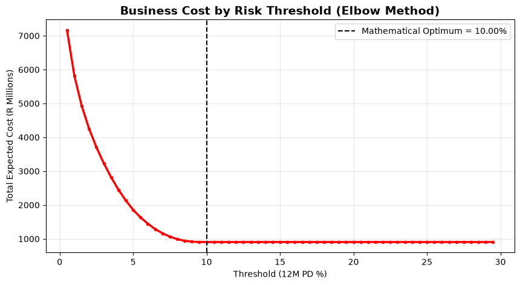
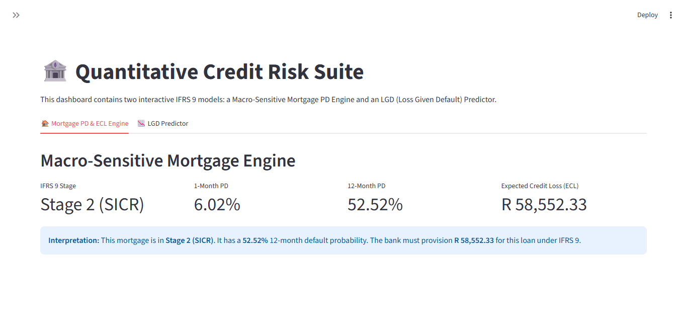
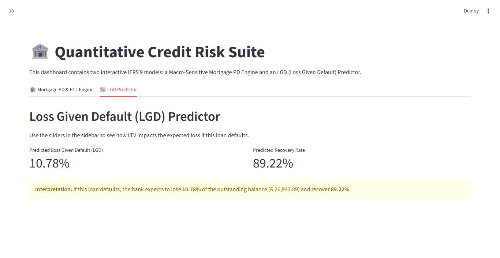
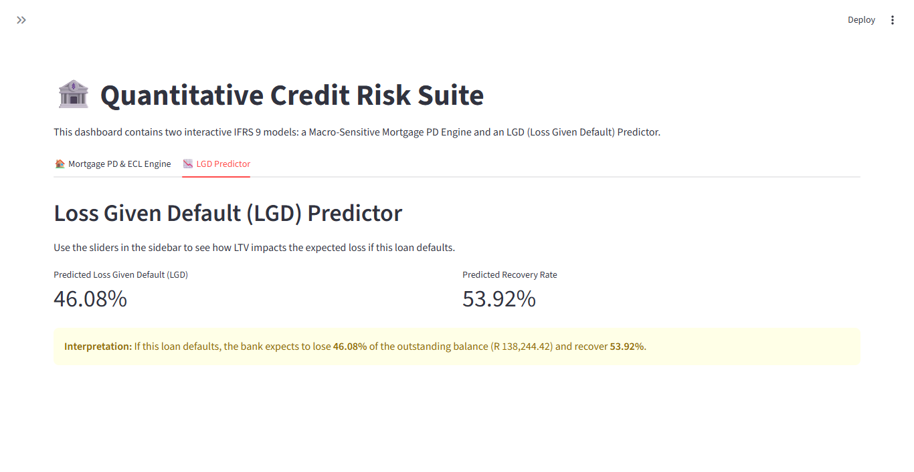
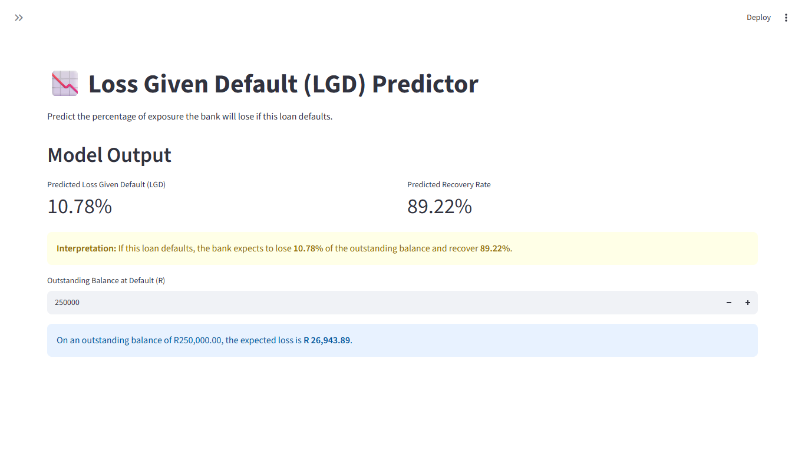

# HomeLoans-IFRS9-Engine
End-to-end Mortgage PD &amp; ECL model with Streamlit deployment.

# Macro-Sensitive Mortgage & LGD IFRS 9 Engine

## Overview
This repository contains two longitudinal quantitative credit risk models: A Macro-Sensitive Mortgage PD/ECL Engine and an LGD (Loss Given Default) Model. They are deployed via an interactive Streamlit dashboard (`app.py`), with a standalone LGD dashboard (`lgd_app.py`) also available.

---

## Project 1: Macro-Sensitive Mortgage Engine
*Built on a 50,000-loan monthly panel tracking the 2008 Global Financial Crisis. See `Mortgage_IFRS9_Engine.ipynb`.*

*   **IFRS 9 Staging Engine:** Built dynamic Stage 1 (Performing), Stage 2 (SICR via LTV > 90%), and Stage 3 (Default) logic.
*   **Lifetime PD & Transition Matrix:** Calculated the monthly roll-rate matrix and mapped the Lifetime PD curve, visually capturing the exact timing of the 2008 default spike.
*   **Modeling:** Trained an XGBoost model (Gini 0.537) using monthly macroeconomic covariates and compared it against a Logistic Regression baseline.
*   **Business Cost Optimization:** Built an Elbow Curve Cost Matrix to determine optimal risk thresholds.
*   **ECL Engine:** Calculated portfolio ECL with realistic coverage ratios (Stage 1: 2.34%, Stage 2: 15.76%, Stage 3: 20.00%).

### Model Validation & Insights

*Figure 1: Champion vs Challenger ROC Curve.*

*Figure 2: Lifetime PD Curve. The marginal default rates (blue bars) spike exactly between months 25–40, corresponding to the 2008 Global Financial Crisis.*

*Figure 3: Threshold Optimization (Elbow Method).*

### Interactive Dashboard: `app.py` (Tab 1 - PD & ECL)

**State 1: Normal Economy**

**State 2: 2008 Crisis Simulation (Triggering Stage 2 SICR)**
By pushing Unemployment to 11% and House Prices down, the LTV breaches 90%, triggering an automatic Stage 2 migration and a massive increase in Expected Credit Loss.

---

## Project 2: LGD (Loss Given Default) Modeling
*Built on a 2,545-loan recovery dataset.*

*   **Target Leakage Detection:** Identified perfect correlation (1.00) between the `lgd_time` feature and the target. Dropped it to prevent a fake model.
*   **Statistical Experiments:**
    *   *IQR Capping (Failed):* Bimodal distribution made IQR bounds mathematically useless (-28 to +16).
    *   *Conditional Model (Failed):* Removing extreme 0s and 1s dropped the R-squared to 0.09.
*   **Final Solution:** Applied 1% and 99% **Winsorization** to stabilize the logit-transformed target. Trained an XGBoost regressor, achieving an **R-squared of 0.2245** (a 24% improvement over the linear baseline).

### Interactive Dashboard: `app.py` (Tab 2 - LGD) & `lgd_app.py`

**Normal Economy LGD:**

**Crisis Economy LGD (Higher LTV = Higher Loss):**

**Standalone LGD Dashboard (`lgd_app.py`):**

---
**Author:** Raymond Sibanda | [LinkedIn](https://www.linkedin.com/in/raymond-sibanda)
