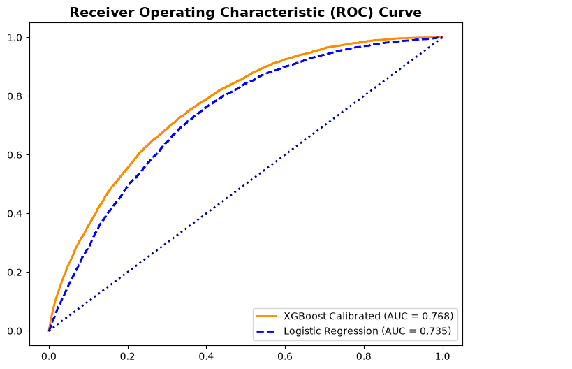
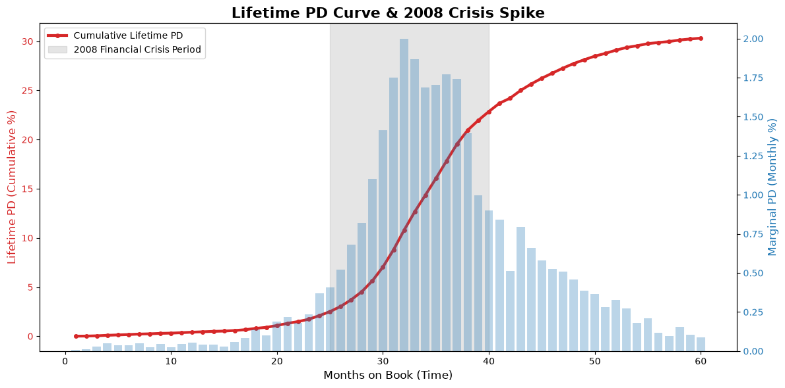
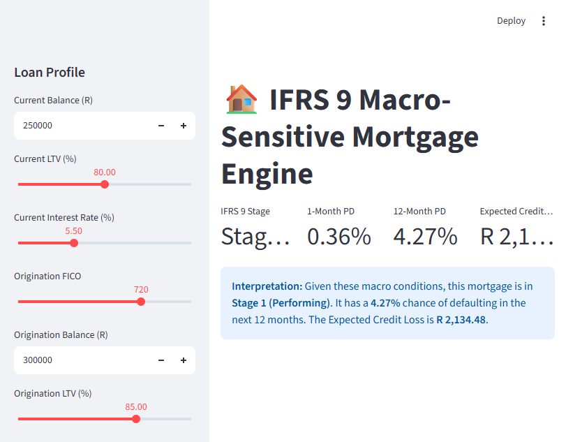
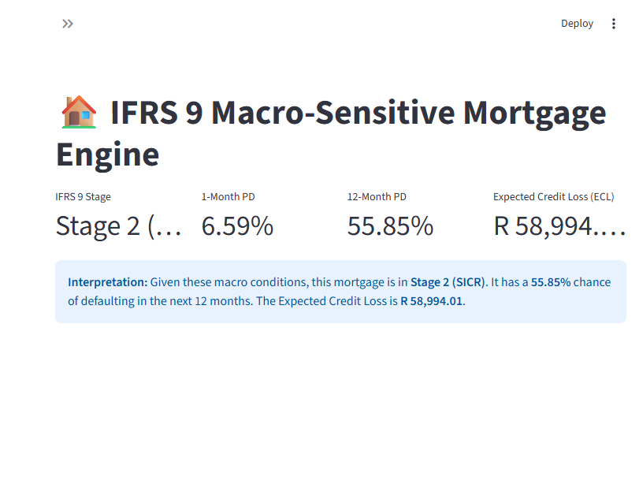

# HomeLoans-IFRS9-Engine
End-to-end Mortgage PD &amp; ECL model with Streamlit deployment.

# Credit Risk & IFRS 9 Quantitative Modeling Portfolio

## Overview
This repository contains two end-to-end quantitative credit risk projects demonstrating proficiency in Probability of Default (PD) modeling, IFRS 9 Staging, Expected Credit Loss (ECL) calculation, and macroeconomic stress testing. 

These projects showcase the ability to handle both **cross-sectional** (application scoring) and **longitudinal** (time-series panel) data.

---

## Project 1: Lending Club IFRS 9 Engine (Cross-Sectional)
*Built on a 1.34M loan dataset (2007–2018).*

*   **Data Engineering:** Extracted a 150,000-loan stratified sample to perfectly preserve historical vintage bad rates. Built a documented data cleaning audit trail.
*   **Modeling:** Trained a Champion Logistic Regression and an XGBoost Challenger. 
*   **Calibration:** Applied Platt Scaling to align predicted PDs with actual default rates.
*   **LGD Estimation:** Calculated historical unsecured LGD at 93.7%.
*   **Stress Testing:** Built a macroeconomic sensitivity engine (0.5x to 2.5x PD shocks).

*Figure 1: Receiver Operating Characteristic (ROC) curve comparing the Champion (XGBoost) and Challenger (Logistic Regression) models.*

---

## Project 2: Macro-Sensitive Mortgage Engine (Longitudinal)
*Built on a 50,000-loan monthly panel tracking the 2008 Global Financial Crisis.*

*   **IFRS 9 Staging Engine:** Built dynamic Stage 1 (Performing), Stage 2 (SICR via LTV > 90%), and Stage 3 (Default) logic.
*   **Lifetime PD & Transition Matrix:** Calculated the monthly roll-rate matrix and mapped the Lifetime PD curve, visually capturing the exact timing of the 2008 default spike.
*   **Champion / Challenger Models:** Trained an XGBoost model (Gini 0.537) using monthly macroeconomic covariates (GDP, HPI, Unemployment) and compared it against a Logistic Regression baseline.
*   **Business Cost Optimization:** Built an Elbow Curve Cost Matrix to determine optimal risk thresholds based on asymmetric false positive/negative costs.
*   **ECL Engine:** Calculated portfolio ECL with realistic coverage ratios (Stage 1: 2.34%, Stage 2: 15.76%, Stage 3: 20.00%).

*Figure 2: Lifetime PD Curve. The marginal default rates (blue bars) spike exactly between months 25–40, corresponding to the 2008 Global Financial Crisis.*

---

## 🚀 Interactive Streamlit Dashboard
I built an interactive web app that allows risk managers to simulate macroeconomic shocks and watch the IFRS 9 Staging and Expected Credit Loss dynamically recalculate in real-time.

To run the app locally:
1. Ensure `xgboost`, `streamlit`, `pandas`, and `joblib` are installed.
2. Run: `streamlit run app.py`

### Dashboard Preview: Normal Economy vs 2008 Crisis
**1. Normal Economy (Stage 1 - Performing)**

**2. 2008 Financial Crisis Simulation (Stage 2 - SICR)**
By pushing Unemployment to 11% and House Prices down, the LTV breaches 90%, triggering an automatic Stage 2 migration and a massive increase in Expected Credit Loss.

---
**Author:** Raymond Sibanda | [LinkedIn](https://www.linkedin.com/in/raymond-sibanda)
FRM | BSc Mathematics
